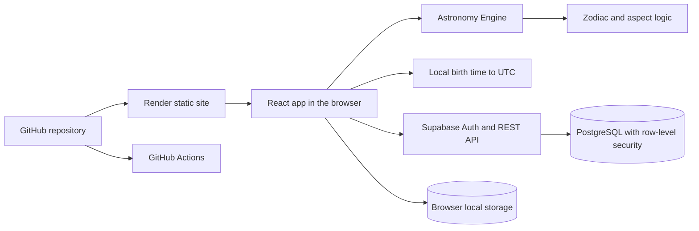

# The Orrery

The Orrery is a personal celestial observatory for exploring current planetary placements, calculating natal Sun, Moon, and planetary signs, and keeping a private observation journal.

**Live app:** [the-orrery.onrender.com](https://the-orrery.onrender.com)

**Source:** [github.com/LordInfamous86/the-orrery](https://github.com/LordInfamous86/the-orrery)

## What it does

- Calculates geocentric ecliptic placements for the Sun, Moon, Mercury, Venus, Mars, Jupiter, and Saturn.
- Maps longitudes to the tropical zodiac and calculates major aspects using declared angular orbs.
- Calculates natal Sun, Moon, and planetary signs from a local birth date, time, and IANA time zone.
- Handles daylight-saving transitions explicitly: nonexistent spring-forward times are rejected, and repeated fall-back times require choosing an occurrence.
- Saves charts and journal entries to Supabase for signed-in users, with PostgreSQL row-level security policies restricting each account to its own rows.
- Works without Supabase configuration using browser-local journal storage. Local-only mode is not account-secured or synchronized.
- Lets users review and explicitly import local journal entries into their signed-in account. The browser copy remains, and duplicate imports are ignored.

The Ascendant, houses, birthplace-based chart features, and chart editing/deletion are outside the current release scope.

## Architecture



GitHub Actions checks the repository with `npm test` and `npm run build`; Render separately builds and serves the static site from the repository.

The browser uses the Supabase publishable/anon key and the signed-in user's access token. The database migration enables row-level security and defines separate owner-only policies for reads, inserts, updates, and deletes. No service-role key belongs in the browser.

## Engineering decisions

### Birth time and daylight-saving changes

Birth date and clock time are entered as local wall time together with an IANA time-zone name, such as `America/Chicago`. The conversion checks possible UTC offsets around the requested date and validates the result by formatting it back into the selected zone. This avoids assuming that a time-zone offset is constant throughout the year. It also exposes the two difficult daylight-saving cases instead of silently changing the user's input.

### Astronomy and interpretation

Astronomy Engine supplies apparent geocentric ecliptic positions. The app converts longitude into twelve equal tropical signs and computes aspect separations from those longitudes. Sign descriptions are traditional astrological interpretations; they are kept separate from the astronomical calculations. The app does not currently calculate houses or an Ascendant.

### Private account data and local notes

Supabase Auth identifies the signed-in user, while PostgreSQL row-level security enforces ownership at the database. Browser-local journal notes are not uploaded automatically. Import is an explicit user action, and a per-user unique key makes retrying an import idempotent.

## Run locally

Requirements: Node.js 18 or later and npm.

```sh
npm ci
Copy-Item .env.example .env.local
npm run dev
```

Vite prints the local URL. Without Supabase settings, calculations still work and journal notes remain in that browser only.

## Configure Supabase

1. Create a Supabase project and copy its project URL and publishable key (or legacy anon key).
2. Put them in `.env.local` using the variable names in `.env.example`.
3. Run `supabase/migrations/0001_private_user_data.sql` in the Supabase SQL Editor.
4. In Supabase Auth settings, enable email/password sign-in and configure the local and production site URLs and redirect allowlist. If email confirmation is enabled, users must confirm their email before signing in.
5. Restart Vite after changing environment values.

Only the publishable/anon key is used by the browser. Never put a Supabase secret or service-role key in a `VITE_` variable or browser code.

## Deploy to Render

The included `render.yaml` configures a static Vite site. Connect the repository to Render and set `VITE_SUPABASE_URL` and `VITE_SUPABASE_PUBLISHABLE_KEY` in the service environment. Render installs dependencies with `npm ci`, builds with `npm run build`, and publishes `dist`.

After deployment, add the production URL to Supabase Auth's Site URL and redirect allowlist. Before sharing a deployment, verify sign-up, email confirmation, sign-in/out, chart saving/loading, and journal create/edit/delete. Use two accounts to confirm that each account sees only its own saved data.

## Quality checks

GitHub Actions runs the test suite and a production build on pushes and pull requests to `main`.

```sh
npm test
npm run build
```

## Calculation scope

The app calculates geocentric positions for seven bodies and maps them into tropical zodiac signs. Its current tests cover zodiac boundaries, aspect wraparound and orbs, invalid dates, time-zone edge cases, and basic astronomical output. Independent multi-date reference comparisons against a published ephemeris are a planned validation improvement.
